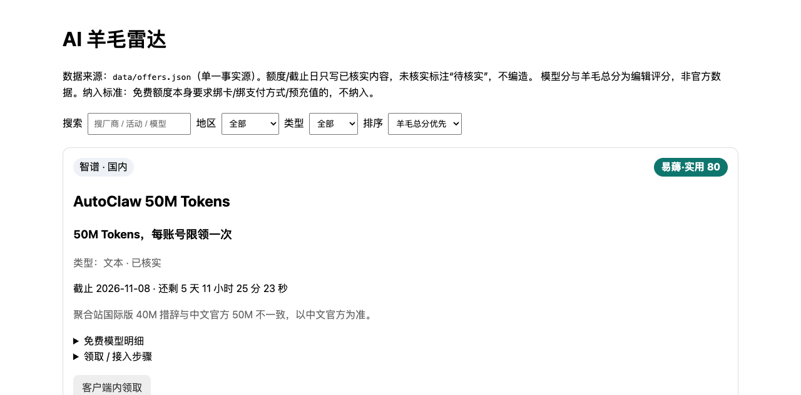

<div align="center">
  
  <h1>AI 羊毛雷达</h1>
  <p><strong>每天巡检官方页面，把值得薅的 AI 免费额度整理成一张可筛选的表。</strong></p>
  <p>
    
    
    
    
  </p>
</div>



## 简介

AI 羊毛雷达（AI Wool Radar）是一个**纯 Python 标准库、无第三方依赖**的免费 AI 额度监控站。
它把活动、额度、截止日、领取链路和编辑评分集中在一个 JSON 文件里，生成静态页面，
并定期巡检官方来源，只在“内容有变化”或“48 小时内到期”时提醒。

项目当前收录 **26 条**免费额度，覆盖国内大厂与海外平台，包含文本、生图、生视频三类能力。

> 所有额度与截止日只写已核实内容；未核实项一律标注“待核实”。模型评分是编辑评分，
> 不是厂商官方数据。

## 特性

- **单一事实源**：`data/offers.json` 是唯一数据入口，页面、评分、倒计时全部由它派生。
- **零依赖运行**：生成、检查、推送、静态服务全部使用 Python 标准库，不需要 pip 安装。
- **每日巡检**：默认在 08:30 / 13:00 / 18:30（Asia/Shanghai）抓取官方页面并比对文本哈希。
- **到期提醒**：只对固定截止日做 48 小时预警，同一条活动只提醒一次；相对期限不硬算。
- **多渠道推送**：Bark、Server酱、Telegram、企业微信、飞书、钉钉、ntfy、Gotify 等。
- **可审计数据**：每条记录保留领取步骤、核实状态、争议说明与排除原因。
- **纳入标准明确**：免费额度本身要求绑卡、绑支付方式或预充值的活动不纳入。

## 快速开始

### Docker（推荐）

```sh
git clone https://github.com/littlepawn/ai-wool-radar.git
cd ai-wool-radar
cp .env.example .env          # 不配置推送渠道也能只看页面
docker compose up --build -d
```

打开 <http://localhost:8080>。

`docker compose` 包含两个服务：

| 服务 | 作用 |
|---|---|
| `web` | 生成并提供静态页面 |
| `checker` | 按 08:30 / 13:00 / 18:30 的节奏运行巡检 |

只想要页面时，运行 `docker compose up --build -d web` 即可。

### 本地运行

需要 Python 3.9+，不需要安装任何包。

```sh
python3 app/generate.py       # 从 data/offers.json 生成 dist/index.html
python3 app/serve.py 8080     # 启动静态服务
```

也可以直接执行 `./run.sh`，它会先生成页面再启动服务。

## 巡检与推送

```sh
python3 app/check.py --dry-run   # 只打印发现，不写状态、不推送
python3 app/check.py             # 正式运行：写入 state/seen.json，必要时推送
python3 app/scheduler.py         # 常驻进程，按固定时段触发检查
```

推送渠道全部通过环境变量配置，完整清单见 [`.env.example`](.env.example)。
常用渠道：

| 渠道 | 环境变量 |
|---|---|
| Bark | `BARK_URL` 或 `BARK_SERVER` + `BARK_KEY` |
| Server酱 Turbo | `SCT_SENDKEY` |
| Telegram | `TELEGRAM_BOT_TOKEN` + `TELEGRAM_CHAT_ID` |
| 企业微信 | `WECOM_WEBHOOK_URL` |
| 飞书 | `FEISHU_WEBHOOK_URL` + `FEISHU_SECRET` |
| ntfy | `NTFY_URL`，可选 `NTFY_TOKEN` |

建议先演练，确认输出格式后再开启真实推送：

```sh
python3 -m app.notify --dry-run --title "测试" --body "这是一条演练，不会真的发出去"
```

## 数据与评分

`data/offers.json` 的结构：

| 字段 | 说明 |
|---|---|
| `offers[]` | 活动列表，包含厂商、额度、类型、领取步骤、截止日、核实状态 |
| `offers[].models[]` | 具名模型的智力 / 额度 / 实用性评分（1–5） |
| `disputed[]` | 来源口径冲突，保留原文说明 |
| `excluded[]` | 已剔除活动及原因 |
| `meta` | 评分公式与数据口径 |

**羊毛总分** = 易薅 × 20 × 45% + 最值得用模型实用性 × 20 × 55%。
没有具名模型时，使用活动级实用性代入，并明确说明不对平台泛称打分。

数据维护是人工审核制：检查器只负责发现变化，是否入库、如何改写仍由维护者判断。

## 部署到 Linux（systemd）

仓库自带 `deploy/` 下的示例单元，默认安装到 `/opt/ai-wool`。
按实际路径调整后执行：

```sh
sudo install -d /opt/ai-wool
sudo cp -a app data assets run.sh /opt/ai-wool/
sudo cp deploy/ai-wool-web.service deploy/ai-wool-check.service deploy/ai-wool-check.timer /etc/systemd/system/
sudo systemctl daemon-reload
sudo systemctl enable --now ai-wool-web.service ai-wool-check.timer
```

默认只监听 `127.0.0.1:8080`。如果要通过 Tailscale 内网访问，把
`ai-wool-web.service` 里的 `HOST` 改成对应的 `100.x.y.z`，不要直接暴露到公网。

推送凭证放在 `/etc/ai-wool.env`（权限 `600`），不要写进仓库或单元文件。

## 目录结构

```text
.
├── app/
│   ├── generate.py    # JSON → 静态页面
│   ├── check.py       # 抓取对比、临期检测、去重推送
│   ├── notify.py      # 多渠道推送
│   ├── scheduler.py   # 定时循环
│   └── serve.py       # 标准库静态服务器
├── data/
│   ├── offers.json    # 唯一事实源
│   └── sources.json   # 巡检来源
├── deploy/            # systemd 示例
├── assets/            # 项目图标
├── docs/              # 页面预览
├── state/             # 检查器状态（不入库）
└── dist/              # 生成产物（不入库）
```

## 安全

- `.env`、`state/`、`dist/` 已在 `.gitignore` 中排除。
- 推送模块只从环境变量读取凭证，`--dry-run` 会对密钥打码。
- 巡检只访问公开页面，不登录、不代领、不绕过任何验证。
- 抓取失败会记为“待人工复核”，不会被当成“没有活动”。

## 已知问题

历史问题与修复记录见 [`BUGS.md`](BUGS.md)，包括泛称条目误评分、倒计时取整不一致、
领取链接指向 API 地址等。

## 免责声明

本项目只汇总公开信息，不提供、不转售任何额度，也不保证活动长期有效。
最终额度、资格与截止时间以厂商官方页面为准。

## License

本项目暂未声明开源许可证。如需复用、分发或商业使用，请先联系作者。
